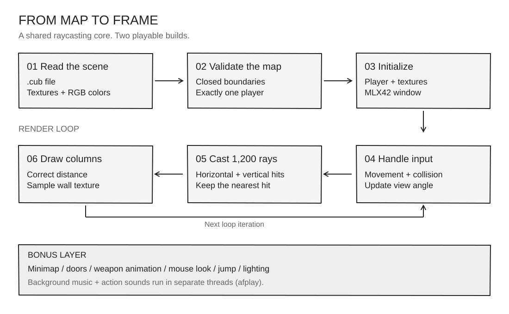
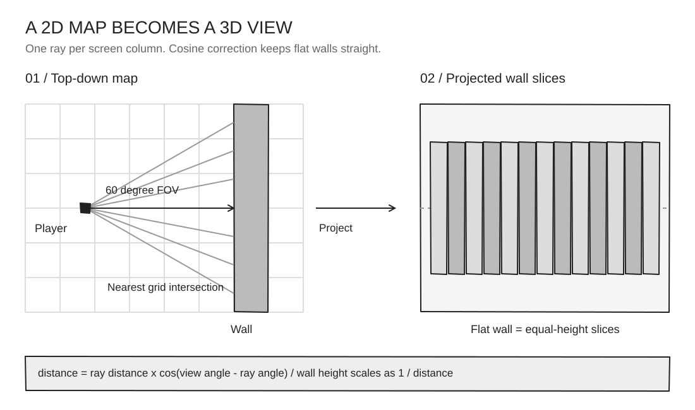

<div align="center">

## Demo

<video src="demo.mp4" controls playsinline preload="metadata" width="900">
  <a href="demo.mp4">Play the cub3D demo</a>
</video>

[Open the video](demo.mp4) · [Open the browser player](docs/demo.html)

# cub3D

**A first-person maze, built from a 2D grid.**

C · MLX42 · Raycasting · 1337 / 42

[Get started](#get-started) · [Controls](#controls) · [How it works](#how-it-works) · [Map format](#map-format)

</div>

---

A Wolfenstein-style raycaster written in C. The engine casts rays through a tile map, finds the nearest wall, and projects textured columns into a first-person view. The mandatory build implements the core renderer; the bonus build adds a minimap, mouse look, weapon animations, sound, and more.

> **Video playback:** `docs/demo.html` provides a browser player for the included recording. GitHub's README renderer needs a GitHub-uploaded video attachment for inline playback; a relative MP4 link does not provide its native player.

## What’s inside

| Mandatory | Bonus |
| :--- | :--- |
| Textured north, south, east, and west walls | Core renderer plus door tiles and target tiles |
| Floor and ceiling colors | Circular minimap and sky background |
| Movement, turning, and wall collision | Mouse look, vertical look, jump, and head bobbing |
| `.cub` parsing and map validation | Animated shooting, aimed shooting, reload, and ammo display |
| 1,200 rays across a 60° field of view | Lighting controls, background music, and action sounds |

The render window is **1,200 × 675** pixels in both builds.

## Get started

Run all commands from the repository root: texture and sound paths are relative to it.

### Dependencies

- A C compiler, Make, and CMake 3.18 or newer.
- GLFW and an OpenGL-capable display.
- The included `MLX42/` source, compiled for your machine.
- macOS `afplay` for the bonus audio implementation.

The supplied Makefile uses a macOS / 42 Homebrew library path. Rebuild MLX42 locally instead of relying on the checked-in build artifacts.

### macOS

Install GLFW and CMake if needed:

```sh
brew install glfw cmake
```

Build the graphics library in a fresh directory, then copy the static library to the path expected by the Makefile:

```sh
cmake -S MLX42 -B MLX42/build-local
cmake --build MLX42/build-local -j
cp MLX42/build-local/libmlx42.a MLX42/build/libmlx42.a
```

Build and launch either version:

```sh
# Mandatory
make
./cub3D mandatory/maps/valid_map1.cub

# Bonus
make bonus
./cub3Dbonus bonus/maps/valid_map1.cub
```

If your Homebrew installation uses a different GLFW path, expose its library directory before running Make:

```sh
export LIBRARY_PATH="$(brew --prefix glfw)/lib:${LIBRARY_PATH}"
```

### Linux

Install your distribution's compiler, Make, CMake, GLFW development libraries, and OpenGL development libraries. Build MLX42 with the same CMake commands above.

The current Makefile omits Linux math and dynamic-loading link flags. You can build the mandatory version by overriding the compiler command:

```sh
make CC='cc -Wl,--no-as-needed -lglfw -ldl -lm -pthread'
./cub3D mandatory/maps/valid_map1.cub
```

The bonus version uses `afplay`, which is macOS-specific; its audio code needs a Linux playback backend before sound will work there.

### Cleanup

| Command | Effect |
| :--- | :--- |
| `make clean` | Remove object files |
| `make fclean` | Remove object files and both executables |
| `make re` | Clean and rebuild the mandatory executable |

## Controls

| Input | Action | Build |
| :--- | :--- | :--- |
| `W` / `S` | Move forward / backward | Both |
| `A` / `D` | Strafe left / right | Both |
| `←` / `→` | Turn left / right | Both |
| `Esc` | Close the window | Both |
| `↑` / `↓` | Look up / down | Bonus |
| Mouse movement | Turn and look while the cursor is captured | Bonus |
| `1` / `2` | Release / capture the mouse cursor | Bonus |
| `J` | Jump | Bonus |
| Left mouse button | Shoot | Bonus |
| Right mouse button | Aimed shot | Bonus |
| `R` | Reload | Bonus |
| `O` / `F` | Turn lighting on / off | Bonus |

Bonus movement and several inputs pause during shooting and reload animations.

## How it works

### From file to frame



[Edit this diagram in Excalidraw](docs/diagrams/architecture.excalidraw)

The parser reads texture paths and colors, builds the map, and checks its boundaries and player spawn. MLX42 loads the images and opens the window. Each loop handles input; when the view changes, the engine casts rays and redraws wall columns. The bonus build also renders its minimap and overlays, with background and action audio handled in separate threads.

### Raycasting and projection



[Edit this diagram in Excalidraw](docs/diagrams/raycasting.excalidraw)

For each ray, the engine checks horizontal and vertical grid intersections and keeps the nearest hit. The hit direction selects the wall texture, and the hit position selects the texture column. A cosine correction removes the fisheye distortion before the wall height is calculated:

```text
corrected_distance = hit_distance × cos(player_angle − ray_angle)
projection_distance = (window_width / 2) / tan(FOV / 2)
wall_height = tile_size × projection_distance / corrected_distance
```

Both diagrams use only black, white, and shades of gray. To edit one, download the `.excalidraw` file and open it through **Open** in [Excalidraw](https://excalidraw.com). The SVG companions make the diagrams visible directly in the README.

## Map format

A `.cub` file declares four wall textures, floor and ceiling RGB colors, followed by the map:

```text
NO ./mandatory/images/textures/north3.png
SO ./mandatory/images/textures/so1.png
WE ./mandatory/images/textures/so2.png
EA ./mandatory/images/textures/we1.png
F 96,96,96
C 224,224,224

111111
100001
10N001
100001
111111
```

| Symbol / directive | Meaning |
| :--- | :--- |
| `NO`, `SO`, `WE`, `EA` | Directional PNG wall textures |
| `F`, `C` | Floor and ceiling RGB values, each component from 0 to 255 |
| `1` | Wall |
| `0` | Walkable floor |
| `N`, `S`, `E`, `W` | The single player spawn and initial facing direction |
| Space | Void outside the playable map |
| `D` | Door tile, bonus only |
| `T` | Target tile, bonus only |

Keep the playable area enclosed by walls, with exactly one player spawn. Bonus doors must sit between opposing walls with an open passage on the other axis. The included wall textures are 1,024 × 1,024 pixels; the renderer's texture sampling assumes this size.

Sample valid and invalid maps are in `mandatory/maps/` and `bonus/maps/`.

## Project layout

```text
.
├── mandatory/       Core engine, parser, player, and renderer
├── bonus/           Extended engine, minimap, weapons, and audio
├── MLX42/           Included graphics library
├── docs/
│   ├── diagrams/    Editable Excalidraw scenes + SVG previews
│   └── demo.html    Browser video player
├── demo.mp4         Demo recording
└── Makefile         Build and cleanup targets
```

## Authors

Built by **zech-chi** and **zelabbas** at **1337 / 42**. Graphics powered by the included MLX42 library.
